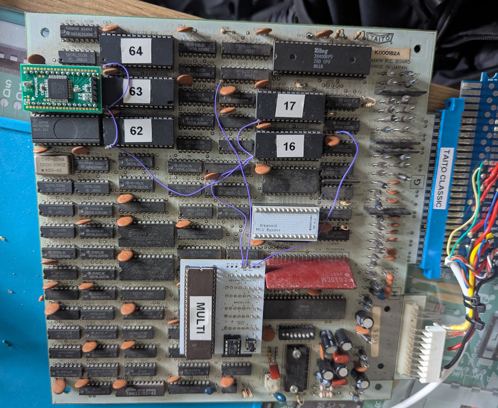
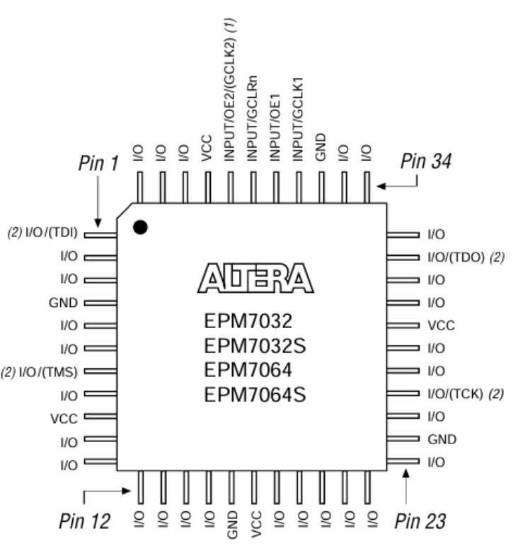
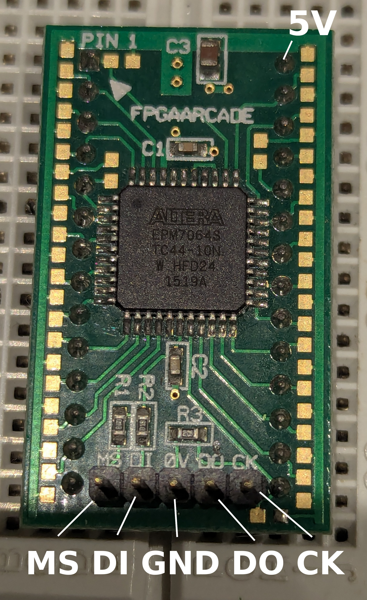
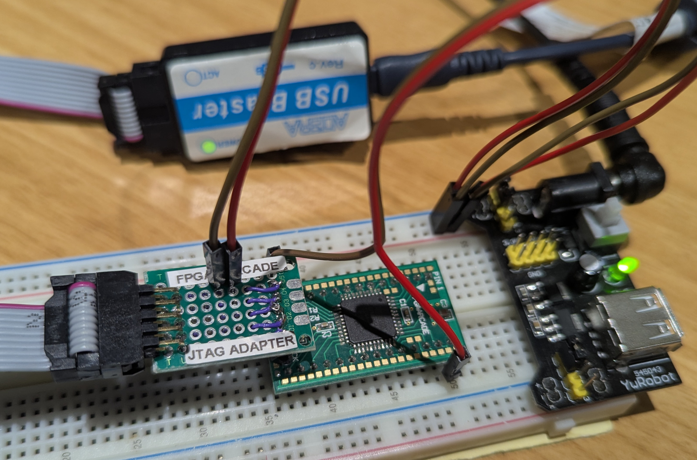

# Taito-MB112S146
 MB112S146 custom chip in verilog

This was created by studying an original IC's behaviour.
It is NOT fully implemented and was only created to work with Arkanoid which I have tested and it seems to work OK using an EPM7064 CPLD.
Thanks to NES4LIFE and Banjo Guy Ollie for loaning me the hardware.

Pictured is an Arkanoid PCB (with fitted multi-kit), and an FPGAArcade module is in the top left replacing one of the MB112S146 customs. The other working custom is directly below it:


## FPGAArcade replacement

Open `MB112S146.qpf` in Quartus II 13.0 SP1. The project targets
`EPM7064STC44-10`; `MB112S146.qsf` contains the board pin assignments below.
These assignments are specific to the adapter traced in this workspace.

| Module pin | Signal | CPLD package pin |
| --- | --- | --- |
| 1 | /Load | 37 |
| 2 | Latch | 40 and 42 (40 assigned; 42 unused input) |
| 3 | IN1 | 43 |
| 4 | IN2 | 44 |
| 5 | Clock | 2 |
| 6–13 | 1D0–1D7 | 3, 5, 8, 11, 12, 13, 14, 15 |
| 14 | GND | Board ground |
| 15 | OUT2 | 18 |
| 16 | OUT1 | 19 |
| 17–24 | 2D7–2D0 | 20, 21, 22, 23, 25, 28, 31, 27 |
| 25 | SEL | 30 |
| 26 | Reverse | 33 |
| 27 | /Clear | 34 |
| 28 | VCC | Board +5V |

All unused I/O pins are configured
as tri-stated inputs, including the extra latch connection at pin 42. JTAG stays
enabled at CPLD pins 1 (TDI), 7 (TMS), 26 (TCK), and 32 (TDO).

## MB112S146 28-pin signal layout

				+----------v---------+
		/Load	|1		  		   28|	VCC
		Latch	|2		  	       27|	/Clear
		IN1		|3		  	       26|	Reverse
		IN2		|4		  	       25|	SEL
		Clock	|5		  	       24|	2D0
		1D0		|6		  	       23|	2D1
		1D1		|7		  	       22|	2D2
		1D2		|8		  	       21|	2D3
		1D3		|9		  	       20|	2D4
		1D4		|10		  	       19|	2D5
		1D5		|11		  	       18|	2D6
		1D6		|12		  	       17|	2D7
		1D7		|13		  	       16|	OUT1
		GND		|14		  		   15|	OUT2
				+--------------------+

## EPM7064S pinout (CPLD on the module)


## Programming setup

The module must be powered during programming, with both 5V and GND connected
to the power supply. Quartus II 13.0.1 (13.0 SP1) with MAX 7000S device support
is required.

An adapter must be made to connect an Altera USB-Blaster JTAG connector to the
module's programming header using the following wiring. Module header pins
below refer to the programming header, not the MB112S146 28-pin signal layout.



| USB-Blaster JTAG pin | Signal | Connection |
| --- | --- | --- |
| 1 | TCK | Module header pin 5 (CK) |
| 2 | GND | Module header pin 3 (GND) |
| 3 | TDO | Module header pin 4 (DO) |
| 4 | VREF | PSU 5 V line |
| 5 | TMS | Module header pin 1 (MS) |
| 9 | TDI | Module header pin 2 (DI) |
| 10 | GND | Module header pin 3 (GND) |

The module internally connects PSU ground to programming-header pin 3 (GND),
so the wiring above shares ground between the module, USB-Blaster, and PSU. So, although both are pictured below, it's only necessary to pass 5V from the PSU to the adapter / JTAG via a flywire and not GND:


Build with Processing > Start Compilation, or:

```sh
/home/[USER]/altera/13.0sp1/quartus/bin/quartus_sh --flow compile MB112S146
```

The programming file is `output_files/MB112S146.pof`. In Tools > Programmer,
select USB-Blaster and JTAG mode, detect the EPM7064S, attach this POF, select
Program/Configure and Verify, then Start.

The following command successfully programmed and verified the connected
EPM7064S.
Run it from the project directory:

```sh
/home/[USER]/altera/13.0sp1/quartus/bin/quartus_pgm -c 'USB-Blaster(Altera) [1-2]' -m JTAG -o 'PV;output_files/MB112S146.pof@1'
```

`PV` requests programming followed by verification; `@1` selects the first
device in the JTAG chain. The cable name is specific to this connection; use
`/home/[USER]/altera/13.0sp1/quartus/bin/jtagconfig` to list connected cables if
it changes. No separate erase command was needed.

**Warning**: using a cheap Altera USB-Blaster clone meant it was necessary to unplug and reconnect the USB-Blaster's USB connection
before programming as there were JTAG access errors. After reconnecting USB, run
the programming command directly.
